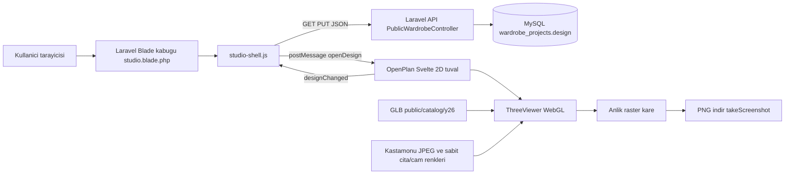

# MEEMARE 3D Dolap Konfigüratörü – Teknik Sistem Analizi

Tarih: 16 Kasım 2026  
Kapsam: `/Users/erkanulker/mobilyatakip` kaynak ağacı. Kod değiştirilmedi.  
Yöntem: Tespitler `composer.json`, `composer.lock`, `package.json`, Laravel denetleyicileri, Blade sayfaları ve `tools/openplan3d/src` altındaki kaynak dosyalarla eşleştirildi. Üretilmiş `public/openplan` paketleri yalnızca “canlı sayfaya giriyor mu?” sorusu için kontrol edildi. Ölçülmemiş FPS, süre ve görsel puan uydurulmadı.

---

## Yönetici özeti

1. **Sistem hangi teknolojilerle yapılmış?**  
   Sunucu tarafı PHP 8.3 ve Laravel 12.70.1. Veri MySQL üzerinde (`DB_CONNECTION=mysql`). Tasarım sayfası bir Laravel Blade kabuğu. Asıl 2D/3D editör, tarayıcıda çalışan Svelte 5 + TypeScript uygulaması OpenPlan 0.9.0. Üç boyut Three.js 0.182.0 ile çiziliyor. React, Next.js, Vue ve React Three Fiber yok.

2. **Dolaplar nasıl oluşturuluyor?**  
   45 hazır modül var: 20 tek kapılı, 20 çift kapılı, 5 köşe. Her modül bir GLB dosyası. Dosya gelene kadar basit bir kutu gösterilir. Raf, çekmece, gövde ve askılık bu GLB’nin içindedir. Kapak, alüminyum çıta, kulp ve LED şeridi kodla, kutulardan eklenir. Ölçü değişince model yeniden üretilmez; mevcut model en, boy ve derinliğe göre gerilir.

3. **Hangi 3D ve render motorları kullanılıyor?**  
   Canlı tasarım sayfası (`/dolap/tasarla`) WebGL raster çizer. Bu, oyunlardaki anlık önizleme yöntemidir. Işın izleme veya path tracing bu sayfada çalışmaz. Path tracing kodu iki yerde durur ve ikisi de bu sayfaya bağlı değildir: eski dolap stüdyosu `public/js/wardrobe-studio.js` içindeki `takeRender`, ve OpenPlan’daki `render-lab` sayfası. Statik OpenPlan derlemesi yalnızca ana editörü paketler; `svelte.config.js` `prerender.entries` değeri `['/']`.

4. **Görüntüler ne kadar gerçekçi?**  
   Fotoğraf kalitesinde değiller. Canlı görüntü, tek kare gölge haritası ve küçük bir renk gradyanıyla çalışan gerçek zamanlı bir önizlemedir. Ahşap, Kastamonu kataloğundan gelen renkli bir resimle boyanır; kabartma (normal map) ve pürüz haritası bu boyamaya eklenmez. Cam, fiziksel bir cam modeli olarak tanımlanır ama path tracing olmadığı için iç yansıma ve gerçek kırılma hesaplanmaz. Bu raporda 10 üzerinden görsel puan verilmedi: puan, kontrol edilmiş bir render setine dayanmazdı.

5. **Profesyonel ticari kullanıma ne kadar hazır?**  
   Müşteri projesini kaydetmek, 2D planda dolap dizmek, 3D önizlemek ve teklif talebi bırakmak için bir iskelet var. Satışa hazır bir fotogerçekçi konfigüratör değil. Fiyat motoru yok. Üretim DXF’i, CNC veya malzeme optimizasyonu bu akışta üretilmiyor. Dolaplar birbirinin içine girebilir. Köşe modülü komşu dolaba geometrik olarak birleşmez. Eski ve yeni iki 3D yığını aynı depoda duruyor; canlı sayfa yenisini kullanıyor.

6. **En büyük beş eksik**  
   - Canlı 3D, path tracing değil; tek kare raster önizleme.  
   - Kapak ve çıta prosedürel kutu; gövde ise ölçeklenmiş GLB. İkisi aynı üretim kalitesinde değil.  
   - Ahşapta yalnız renk dokusu var; normal ve roughness haritası yok. Ortam haritası 64×32 piksel bir gradyan.  
   - Modüller arasında çarpışma yok. Sunucu, plan koordinatının oda dışında olup olmadığına bakmıyor.  
   - Yüksek kaliteli render düğmesi canlı sayfada yok. Eski stüdyodaki `takeRender` bu rotada yüklenmiyor.

7. **Gerçekçiliği artırmak için ilk ne yapılmalı?**  
   Önce canlı sayfadaki malzemeyi düzeltmek: Kastamonu dokusuna roughness haritası, gövdeye tutarlı PBR değerleri, cama path tracing olmadan da okunan bir ortam yansıması ve tek bir gölge ışığı yerine oda içi alan ışıkları. Path tracing ancak bu malzeme katmanı düzelince “yüksek kalite” düğmesi olarak eklenmeli. Mevcut `takeRender` canlı sayfaya bağlı olmadığı için bugün müşteri o düğmeyi göremez.

---

## 1. Yazılım altyapısı

### Diller ve çalışma şekli

| Katman | Dil | Ne işe yarıyor |
|---|---|---|
| Sunucu | PHP | Kimlik, proje kaydı, teklif, malzeme listesi |
| Şablon | Blade | Tasarım sayfasının kabuğu |
| Canlı köprü | JavaScript | `public/js/studio-shell.js` |
| 2D/3D editör | TypeScript + Svelte 5 | `tools/openplan3d/src` |
| Eski stüdyo | JavaScript | `public/js/wardrobe-studio.js` (canlı tasarım rotasında yüklenmez) |
| Veri | SQL | `wardrobe_projects.design` JSON sütunu |

React, Next.js, Vue, Babylon.js ve React Three Fiber kaynakta yok. `package.json` dosyalarında bu isimler geçmiyor.

### Sürümler (kilit dosyalarından)

- PHP sınırı: `composer.json` içinde `"php": "^8.3"`.
- Laravel: `composer.lock` içinde `laravel/framework` `v12.70.1`.
- PDF: `barryvdh/laravel-dompdf` `v3.1.2`. Teklif PDF’i dolap akışında kullanılmıyor; genel muhasebe/teklif yazdırma paketidir.
- Excel: `maatwebsite/excel` `4.0.5`. Müşteri ve tedarikçi aktarımı içindir, dolap 3D’si için değil.
- OpenPlan paket sürümü: `tools/openplan3d/package.json` içinde `"version": "0.9.0"`.
- Three.js: aynı dosyada `"three": "^0.182.0"`. Kurulu paket `tools/openplan3d/node_modules/three/package.json` içinde `0.182.0`.
- Svelte `^5.57.0`, SvelteKit `^2.70.3`, Vite `^7.3.7`, TypeScript `^5.9.3`, Tailwind `^4.1.18`.
- Path tracer kütüphanesi: `three-gpu-pathtracer` `0.0.24` ve `three-mesh-bvh` `0.9.10`. Bunlar OpenPlan bağımlılığıdır. Canlı editör sahnesi bunları çağırmaz.
- Laravel arayüz derlemesi ayrıdır: kök `package.json` içinde Vite `^7.0.7`, Tailwind `^4.0.0`, `laravel-vite-plugin` `^2.0.0`. Dolap tasarım sayfası bu Vite paketini yüklemez.

### Frontend ve backend

Kullanıcı `/dolap/tasarla` adresine gelir. Rota `routes/web.php` içinde `PublicWardrobeController::design` ve `auth` altındadır. `design()` `wardrobe.studio` görünümünü döner (`app/Http/Controllers/PublicWardrobeController.php`).

Bu sayfa tam ekran bir `iframe` açar. `iframe` adı `meemare-studio-plan`, adresi `/openplan/?embed=1&v=301` şeklindedir. Proje varsa sorguya `design=1` eklenir (`public/js/studio-shell.js`, `openFrame`). Kaynak şablon `resources/views/wardrobe/studio.blade.php` yalnızca `studio-shell.js` yükler. `wardrobe-studio.js` bu sayfada yoktur. `tests/Feature/WorkshopToolsAccessTest.php` de tasarım sayfasında bu dosyanın görünmemesini bekler.

Eski stüdyo dosyası duruyor: `resources/views/wardrobe/index.blade.php` satır 1161 `wardrobe-studio.js` yükler. `design()` bu görünümü döndürmez. `wardrobe.index` rota adı proje listesidir, eski 3D sayfası değildir.

### Veritabanı ve API

- Varsayılan bağlantı kodu `config/database.php` içinde `env('DB_CONNECTION', 'sqlite')`. Çalışan `.env` satırı `DB_CONNECTION=mysql`. Parola ve sunucu bu raporda yok.
- Tablo `wardrobe_projects`: `database/migrations/2026_10_31_000002_create_wardrobe_projects_table.php`. Sütunlar `id`, `token`, `customerName`, `phone`, `projectName`, `note`, `design` (JSON), `createdAt`, `updatedAt`. `userId` ayrı migrasyonda eklenir.
- Kayıt: `PUT /dolap/proje/{token}`. Gövde `WardrobeDesign::validated()` içinden geçer ve fazladan anahtarlar silinmez; doğrulama geçerse aynı dizi geri döner (`app/Support/WardrobeDesign.php`, `validated`, satır 141 `return $design`).
- Teklif: `POST /dolap/teklif`, `PublicWardrobeController::quote`. Fiyat hesaplamaz. `wardrobe_quotes` tablosuna ad, telefon, not ve tasarım JSON’u yazar. Yanıt metni: “Talebiniz alındı. Atölye sizinle iletişime geçecek.”
- Malzeme: `GET /dolap/malzemeler`, `materials()`. Kastamonu gruplarını `resource_path('data/catalog/kastamonu-entegre')` altından okur. Beş grup tanımlıdır: Glossmax Pro, Laklı Panel, Boyalı Panel, Melamin Kaplı Panel, Compact Panel.

### Klasör mimarisi (dolapla ilgili olanlar)

- `app/Http/Controllers/PublicWardrobeController.php` — sayfa, kayıt, teklif, malzemeler.
- `app/Support/WardrobeDesign.php` — tasarım JSON doğrulaması.
- `resources/views/wardrobe/studio.blade.php` — canlı tasarım kabuğu.
- `resources/views/wardrobe/index.blade.php` — eski stüdyo şablonu, tasarım rotasına bağlı değil.
- `public/js/studio-shell.js` — iframe ile sunucu arasındaki köprü.
- `public/js/wardrobe-studio.js` — eski WebGL stüdyo ve path tracer.
- `public/catalog/y26/*/model.glb` — dolap modelleri.
- `public/openplan/` — OpenPlan’ın statik derlemesi.
- `tools/openplan3d/` — OpenPlan kaynağı. Ayrı bir git klonu olarak durur; asıl uygulama Laravel’dir.
- `routes/web.php` — `/dolap`, `/openplan`, ayrıca satış, stok, atölye, teklif gibi iş uygulaması rotaları.

Bu depo yalnız bir dolap uygulaması değil. Müşteri, stok, kasa, satış ve atölye Laravel modülleri aynı uygulamadadır. Dolap konfigüratörü bu uygulamanın bir modülüdür.

### Yüklü olup dolap önizlemesinde kullanılmayan paketler

OpenPlan `package.json` bağımlılıkları arasında şunlar dolap önizlemesinin çizim döngüsünde çağrılmaz:

- `three-gpu-pathtracer` ve `three-mesh-bvh`: yalnız `src/lib/renderLab/viewer.ts`. Bu sayfa statik derlemenin prerender listesinde yok.
- `firebase` ve `google-auth-library`: `src/routes/+layout.svelte` analitik açıksa Firebase’i dinamik import eder. Dolap kaydı Firebase’e yazılmaz.
- `dxf-writer`, `jspdf`, `jszip`: plan dışa aktarma araçları. Canlı dolap sayfasının kayıt fonksiyonu bunları çağırmaz.
- `fake-indexeddb`, Playwright, Vitest: test araçları.
- Kök Laravel paketlerinden Dompdf ve Excel: muhasebe ve yazdırma. `quote()` PDF üretmez.

---

## 2. 3D motoru ve modelleme sistemi

### Motor

Canlı sahne `tools/openplan3d/src/lib/components/viewer3d/ThreeViewer.svelte` içindedir. `init` sırasında `new THREE.WebGLRenderer({ antialias: true, preserveDrawingBuffer: true })` kurulur. `renderer.shadowMap.type = THREE.PCFSoftShadowMap`. `renderer.toneMapping = THREE.ACESFilmicToneMapping`. Stüdyo görünümünde pozlama `1.22` yapılır. WebGPU oluşturucusu (`WebGPURenderer`) bu dosyada yok.

### GLB mi, kod mu?

İkisi birden, bu sırayla:

1. `createFurnitureModelWithGLB` (`furnitureModelLoader.ts`) hemen `createFurnitureModel` ile prosedürel bir yedek üretir (`furnitureModels3d.ts`).
2. `getModelFile(catalogId)` bir yol dönerse `loadCatalogModel` GLB’yi yükler (`furnitureModelResources.ts`, `GLTFLoader`).
3. GLB gelince yedek kaldırılır, GLB konteynıra eklenir, `mountWardrobeOptions` kapak grubunu yeniden kurar.

Dolap dosya yolları `meemareWardrobes.ts` içinde `meemareModelFiles` ile sabittir. Örnek: `y26_tek_01: '/catalog/y26/y26_tek_01/model.glb'`. Yol `/` ile başladığı için `loadCatalogModel` onu olduğu gibi ister. Başarısız yükleme 30 saniye sonra yeniden denenebilir (`MODEL_RETRY_DELAY_MS`).

Kaynak GLB oturum boyunca bir `Map` içinde tutulur. Her yerleştirme `cloneModel` ile geometri, malzeme ve dokuyu kopyalar. Bu, GPU instancing değildir. Aynı dolaptan on tane koymak on kopya geometri demektir.

### Ölçü

Katalog ölçüleri santimetredir. Tek kapılı örnek `width: 45`, `depth: 60`, `height: 250` (`meemareWardrobes.ts`). `fitFurnitureModel` modelin sınır kutusunu ölçer ve `def.width / size.x`, `def.height / size.y`, `def.depth / size.z` ile ölçekler. Sonra modeli X/Z’de ortalar, tabanı Y=0 yapar. Ölçü değişince raf aralığı yeniden hesaplanmaz; tüm GLB, raflar ve çekmecelerle birlikte gerilir.

Sunucu sınırları `WardrobeDesign::validated` içindedir: genişlik 2–200, yükseklik 40–320, oda duvarı 80–800, oda yüksekliği 160–320. Köprü `studio-shell.js` `clamp` ile genişliği ayrıca 30–200, derinliği 30–80 yapar.

### Raf, çekmece, kapak, askılık

GLB düğüm adı parçayı belirler. `partRole` (`furnitureModelLoader.ts`):

- `aski`, `kiyafet`, `kulp`, `handle` boyanmaz (`keep`).
- `arkalik` arkalık.
- `cekmece` / `drawer` çekmece.
- `raf` / `shelf` raf.
- `govde`, `baza`, `outer` gövde.
- Eşleşmeyen ad, üst düğüme bakılır; o da yoksa gövde sayılır (`roleOf`).

Kapak GLB’de yoktur. `buildWardrobeOptions` bir `wardrobe-options` grubu ekler:

- Çerçeve 1,6 cm kesitli dört kutu. Malzeme `MeshStandardMaterial`, metalness `0.82`, renk `aluminumById`.
- Ahşap kanat yaklaşık 1,1 cm kalınlığında kutu. Varsa `finishImage` dokusu yapıştırılır.
- Cam kanat `MeshPhysicalMaterial`: `transmission`, `thickness: 0.5`, `ior: 1.5`, seçilen cam rengi.
- Aynalı katalog adı `doorHint` ile `mirror: true` olur. Ayna `metalness: 1`, `roughness: 0.06`.
- Kulp 14 cm yüksekliğinde ince bir kutu.
- LED açıksa 0,5 cm yüksekliğinde emissive bir şerit.
- Çift kapılı katalogda `doorCount` 2’dir (`createPlacedFurnitureModel`). Diğerlerinde 1.

Baza, GLB’de adı `baza` geçen ağdır. `applyBaza` `plinth === false` ise gizler. `plinthHidden` ise ağı yerel Z’de 6 cm içeri kaydırır.

`doorHint` katalog adına bakar: “ayna”, “füme”, “bronz”, “cam”, “şeffaf”, “vitrin”. Eşleşme yoksa kapak ahşap, çıta `al-inox` olur. Kullanıcı `doorStyle` vermişse o kazanır.

### Yan yana dizme

Ayrı bir “modül dizme” algoritması yok. Her dolap planda bağımsız bir mobilyadır: `position.x`, `position.y`, `rotation`. Duvara yaklaşınca `snapFurnitureToWalls` (`furnitureGeometry.ts`) çalışır.

Algoritma: mobilya merkezi her düz duvar doğru parçasına izdüşürülür. Eğri duvar (`curvePoint`) atlanır. Duvar, mobilya genişliğinden kısaysa atlanır. Merkezin duvar yüzeyine uzaklığı ile yarı derinliğin farkı `WALL_SNAP_DIST` (12 cm, `canvasInteraction.ts`) içindeyse en yakın duvar seçilir. Merkez, arka kenar duvar yüzeyine değecek kadar itilir ve duvar boyunca mobilya yarı genişliği kadar içeride tutulur. Dönüş, duvar açısına göre ayarlanır.

Dolap GLB’sinin önü 0 derecede planın −Y yönüne bakar. `wardrobeFacing` (`studioDesign.ts`) duvar açısına 180 ekler. Bu fonksiyon `FloorPlanCanvas.svelte` yerleştirmesinde çağrılır.

### Köşe

Köşe, iki dolabın geometrik birleşimi değildir. `y26` kataloğunda beş ayrı “Köşe” GLB’si vardır. Kayıtta `moduleFromPlan` katalog kimliği `kose` ile başlıyorsa `kind: 'corner'` yazar ve `cornerSide` değerini `x < oda genişliği / 2` ise sol, değilse sağ yapar. `WardrobeDesign` aynı tarafta birden fazla köşeyi reddeder. 3D sahnede bu modül diğerleri gibi tek bir GLB olarak durur. Komşu gövdeyle gönye, ortak yan panel veya bindirme hesabı yoktur.

### Sürükle-bırak

2D tuval `FloorPlanCanvas.svelte`.

- Katalog kartı `placingFurnitureId` yazar.
- Tuval tıklaması `addFurniture` çağırır. Yakın duvar varsa konum ve dönüş `snapFurnitureToWall` + `wardrobeFacing` ile gelir.
- Sürükleme `transformFurnitureDuringDrag` ile konumu günceller. Duvar 12 cm içindeyse tekrar yapışır.
- Bırakılınca sürükleme durumu temizlenir.

3D sahnede dolap sürüklenmez. 3D tıklama duvar seçmek içindir (`raycaster.intersectObjects`). Dolap seçimi ve özellik paneli 2D plandadır. Özellik değişince sahne imzası değişir ve 3D yeniden kurulur (`sceneSignature`).

### Çarpışma ve duvar sınırı

Mobilya–mobilya kesişmesini reddeden bir fonksiyon bulunamadı. `collision` geçen yerler dosya adı çakışması ve oda poligonu içindir, dolap kutusu değildir.

Duvar sınırı ikiye ayrılır:

- Yerleştirirken duvar yapışması isteğe bağlıdır. Uzaktayken dolap serbest konur. Kod, dolabı oda poligonunun içinde tutan bir test çağırmaz.
- Sunucu `offset + genişlik` değerini duvar boyuyla karşılaştırır. Köprü ise her modülde `offset: 0` ve `wall: 'front'` yazar. Asıl konum `planX` / `planY` alanlarındadır ve bu karşılaştırma o alanlara bakmaz. Genişlik duvara sığıyorsa, oda dışındaki bir `planX` kayıtta kalabilir.

---

## 3. Görüntü kalitesi ve gerçekçilik

### Canlı sayfada kullanılan yöntem

`ThreeViewer` her karede `renderer.render(scene, camera)` çağırır (`animate`). Bu ileri rasterizasyondur: üçgenler ekrana boyanır, ışık piksel gölgelendiricisinde yaklaşık hesaplanır. Işın sahneye geri dönmez.

WebGPU, donanım ışın izleme ve path tracing bu döngüde yok.

Stüdyo (`window.name === 'meemare-studio-plan'`, `studioView`) ışıkları:

- Ortam ışığı `0.72`.
- Yarım küre ışığı `0.55`.
- Güneş `DirectionalLight`, şiddet `1.25`, gölge haritası `2048×2048`, kapsama `±450` cm, `bias -0.00015`, `normalBias 0.8`.
- Dolgu ve kenar ışığı gölge düşürmez.
- Ortam yansıması 64×32 tuval gradyanıdır (`#f8f4ee` → `#ecd9c2` → `#8a7360`), `EquirectangularReflectionMapping`.
- Duvar ağları stüdyoda gölge düşürmez: `mesh.castShadow = !studio` (yaklaşık satır 1404 ve 1449). Dolap ağları `castShadow = true` alır.

Gölge tek bir yön ışığının haritasıdır. Yumuşak gölge PCF’dir. Ortam kapanması (ambient occlusion), global illumination ve caustic yoktur.

### PBR ve malzemeler

Three.js `MeshStandardMaterial` metalness/roughness modelini kullanır. Bu bir PBR yaklaşımıdır. Canlı dolap boyaması onu şu değerlere çeker (`finishWardrobeMaterial`):

- Gövde: roughness `0.4`, metalness `0.06`.
- Arkalık: roughness `0.78`, metalness `0.02`.
- Çekmece ve raf: roughness `0.58`, metalness `0.02`.
- `envMapIntensity` `0.95`.

Kastamonu seçimi bir JPEG bağlar (`TextureLoader`). Renk uzayı SRGB, sarmalama `RepeatWrapping`. Doku varsa malzeme rengi beyaza çekilir ki doku boyanmasın. `normalMap`, `roughnessMap` ve `aoMap` bu fonksiyonda atanmaz. Lake, mat melamin ve kompakt panel aynı roughness sayılarını kullanır. Grup adı (`finish_hint`: highgloss, gloss, matte) 3D malzemeye bağlanmaz. `materials()` bu ipucunu JSON’a koyar; `applyWardrobeParts` onu okumaz.

Ahşap kapak, gövde renginin veya `finishImage` dokusunun düz bir kutu üzerine gerilmesidir. Metal çıta sabit metalness `0.82` ve seçilen hex renktir. Fırçalanmış metal dokusu yoktur.

Cam `MeshPhysicalMaterial` ile `transmission` alır. Üst sınır, raster önizlemede ekran ortam dokusunun kabaca örneklenmesidir. Ortam dokusu 64×32 olduğu için yansıma bulanık bir renk wash’idir. `opacity` cam rengine göre `0.18` ile `0.62` arasındadır (`wardrobeHardware.ts`). Path tracing olmadığı için camın arkasındaki raf, ekran uzayında saydamlıkla görünür; ışık camın içinde sekmez.

Eski stüdyo (`wardrobe-studio.js`) ahşaba prosedürel `normalMap` ve `roughnessMap` bağlar (yaklaşık satır 876–1141). Bu kod canlı sayfada çalışmaz.

### Örnekleme, kenar yumuşatma, ton

- Kenar yumuşatma: `antialias: true`. Çoklu örnek sayısı (MSAA sample count) kodda yazılmaz; tarayıcının WebGL varsayılanına kalır.
- Piksel oranı: ana görüntü `window.devicePixelRatio` ile kurulur, üst sınır konmaz (`setPixelRatio` satır 822). Küçük önizleme görüntüleri oran `1` kullanır.
- Ton eşleme: ACES Filmic, stüdyo pozlaması `1.22`.
- Denoise: canlı döngüde yok.
- Sample sayısı: canlı döngüde yok. Her kare bir raster geçiştir.

### Gerçek zamanlı görüntü ile yüksek kalite render

Gerçek zamanlı görüntü, her karede yaklaşık ışık kullanır ve milisaniyeler içinde biter. Yüksek kalite, bu depoda `three-gpu-pathtracer` ile tanımlanmıştır: GPU’da Monte Carlo ışınları biriktirilir, sonra gürültü azaltılır. Bu, canlı `animate` fonksiyonunda yoktur.

Kod, fotogerçekçi bir tavan tanımlamaz. Üst sınır bugünkü malzemelerle “temiz bir ürün önizlemesi”dir. Eksikler:

- Kapak geometrisi dört kutu ve bir paneldir. Pah, conta, cam fitili ve gerçek profil yoktur.
- GLB ölçeklenir. 45 cm model 90 cm olunca çekmece ve raf oranları da büyür.
- Lake ile mat aynı roughness sayısını alır.
- Ortam haritası bir gradyandır. Metal ve camın yansıtacağı bir oda yoktur.
- Tek gölge ışığı 450 cm’lik bir alana 2048 piksel yayar. Küçük baza gölgesi bu çözünürlükte erir.
- Duvarlar gölge düşürmez. Dolap–duvar teması düz kalır.
- Cam transmission, path tracing örneklemesi olmadan fiziksel cam gibi birikmez.

### 10 üzerinden puan

Görsel sonuçlar bu rapor için kontrollü bir set halinde incelenmedi. Tek bir ekran görüntüsü puan için yeterli değildir. Bu yüzden 10 üzerinden kesin puan verilmedi.

Kodun sağladığı tavan, kategorilere göre şöyle okunur:

| Başlık | Kodda olan | Bunun anlamı |
|---|---|---|
| Geometri | Hazır GLB + kutu kapak | Gövde modelden gelir, kapak basit |
| Malzemeler | Metalness/roughness sayıları, renk JPEG’i | PBR iskelet var, katmansız |
| Işıklandırma | 1 gölgeli yön ışığı + ortam + dolgu | Gerçek zamanlı oda ışığı |
| Gölgeler | 2048 PCF, duvar gölge düşürmez | Tek yön, sınırlı çözünürlük |
| Yansımalar | 64×32 gradyan ortam | Ayna ve metal bulanık renk verir |
| Cam | Physical transmission, path trace yok | Saydam panel, fiziksel cam değil |
| Ahşap dokusu | Katalog JPEG’i, normal/roughness yok | Renkli sticker etkisi |
| Final render | Canlı sayfada tek raster kare | Biriktirilmiş sample yok |

---

## 4. Render süreci

Canlı sayfada “yüksek kaliteli render” butonu yoktur. Müşterinin 3D araç çubuğunda gördüğü kayıt, anlık WebGL karesinin PNG’ye çevrilmesidir.

### Canlı sayfa: `takeScreenshot`

Dosya: `ThreeViewer.svelte`, fonksiyon `takeScreenshot`.

1. `renderer.render(scene, camera)` bir kare çizer.
2. Tuval `toDataURL('image/png')` ile okunur. `preserveDrawingBuffer: true` bu okumaya izin verir.
3. Tarayıcı `floorplan-3d.png` indirir.

Çözünürlük, tuvalin o anki CSS boyutu çarpı `devicePixelRatio` değeridir. Sabit 1920×1080 veya 4K yoktur. Sample sayısı 1 raster geçiştir. İş GPU’da WebGL ile yapılır. CPU’da biriktirme yoktur. Denoise yoktur. Aynı dosyada `exportBlenderScene` sahneyi JSON olarak indirir. Dokuların ve kameraların atlandığını kendi mesajı yazar: “Textures and photo cameras are omitted.”

### Eski stüdyo: `takeRender` (bu rotada yüklü değil)

Dosya: `public/js/wardrobe-studio.js`, fonksiyon `takeRender`. Şablon `resources/views/wardrobe/index.blade.php` onu import eder ve `three-gpu-pathtracer@0.0.23` adresini CDN import map’ine koyar. `PublicWardrobeController::design` bu şablonu döndürmez.

Fonksiyon yine de depoda durduğu için adımları şöyledir:

1. Seçim ve ölçü çizgileri kapatılır, sahne `rebuild` edilir.
2. Kare boyutu: en uzun kenar varsayılan `1600` piksel (`window.__ultraMax` 400’den büyükse o). En-boy, kameranın o anki oranından veya dolap kutusundan gelir. Piksel oranı bu sırada `1` yapılır.
3. Zemin geçici büyütülür, arka plan `#f4f1ec`, pozlama `1`.
4. `prepareTraceTextures` çalışır. Camda `thickness` `0` ve `attenuationDistance` sonsuz yapılır. Yorum, path tracer 0.0.23’ün siyah cam hatasını gerekçe gösterir.
5. Ortam: `window.__traceEnv` değerine göre HDRI, oda yansıması veya `GradientEquirectTexture`.
6. `new WebGLPathTracer(renderer)`. Karo `2×2`. Varsayılan geçiş `18` (`window.__ultraPasses` 4’ten büyükse o). Hedef sample `passes * 2 * 2` olur. Varsayılan hedef `72` sample.
7. Sekme sayısı varsayılan `4`, saydam sekme `5`. `multipleImportanceSampling = true`. `filterGlossyFactor = 0.55`.
8. `setScene` BVH kurar. Sonra `renderSample` döngüsü, ya hedefe varır ya da `150000` ms bütçe dolar.
9. GPU denoise: `DenoiseMaterial`, sigma varsayılan `2.4`, kSigma `1.8`, threshold `0.055`. Hata olursa tuval üstünde CPU `denoiseRender`.
10. PNG data URL `window.__renderImage` içine yazılır. Süre ve sample `window.__renderStats` içine konur.

Bu sayılar kaynak koddadır. Bu rapor sırasında o fonksiyon çalıştırılmadı. Süre ölçümü yoktur.

İş GPU üzerindedir (`WebGLPathTracer`). Çıktı, tuvalin PNG’sidir. Sunucuya otomatik kaydedildiğine dair bir çağrı bu fonksiyonda yoktur.

### Ayrı laboratuvar: `createViewer`

Dosya: `tools/openplan3d/src/lib/renderLab/viewer.ts`. Kullanıcı bir GLB seçer. `WebGLPathTracer` kurulur: `bounces = 6`, karo `3×3`, doku `1024×1024`, sample tavanı `512`. Denoise sigma `2`. Ton eşleme AgX. Gölge `2048`. Statik derleme `svelte.config.js` içinde yalnız `'/'` yolunu prerender eder. Yorum: “render-lab/API statik taramada değil.” `public/openplan` altında `render-lab` HTML’i yoktur. Bu laboratuvar canlı dolap sayfasına bağlı değildir.

### Fotoğrafa yaklaşmak için eksik aşamalar

Canlı çıktı ile `takeRender` arasındaki fark sample birikimidir. `takeRender` de fotoğraf değildir: 72 sample, 4 sekme, 1600 piksel ve prosedürel kapakla sınırlıdır. Eksik olanlar: ölçülmüş malzeme (roughness haritası), gerçek iç mekân HDRI, çok ışık, daha yüksek sample, kapak profil geometrisi ve canlı sayfaya bağlı bir çıktı kaydı.

---

## 5. Performans analizi

Bu rapor için FPS veya render süresi ölçülmedi. Aşağıdakiler kodun yapısından çıkar.

### GPU ve bellek

- Bir `WebGLRenderer`. Piksel oranı cihazın oranıdır, tavan yoktur. Yüksek DPI ekranda tuval pikseli CSS boyutunun katıdır.
- Bir `2048×2048` gölge haritası.
- Her dolap `cloneModel` ile kendi geometri, malzeme ve doku kopyasını alır. Kaynak GLB önbelleği paylaşılır (`sources` Map). Kopyalar paylaşılmaz.
- Kastamonu JPEG’i her parça rolü için ayrı `TextureLoader` ile gelir. Doku GPU’ya yüklenir ve model silinince `dispose` edilir (`releaseWithModel`).
- Çizim, sahne kirliyse yapılır (`sceneDirty`). Orbit sönümlemesi bitince döngü bekler. Bu, boşta sürekli çizimi keser.

### Çok dolap neden ağırlaşır

- Her GLB kopyası ayrı çizim çağrısı üretir. `InstancedMesh` dolap yolunda kullanılmaz. `portableRenderScene.ts` yalnızca bu tipi dışarı aktarırken eler.
- LOD yok. Uzak dolap da tam üçgenle çizilir.
- `fitFurnitureModel` ve parça boyama her yüklemede tüm ağı gezer.
- Özellik değişince sahne imzası değişir ve görünen kat yeniden kurulur (`rebuildScene`). Bu, küçük bir renk değişiminde duvar ve mobilyayı baştan kurabilir. Kamera, bağlam aynıysa korunur (`shouldFrameScene`).
- Gölge haritası tüm odayı `±450` cm tarar. Dolap sayısı artınca aynı haritaya daha çok nesne yazılır.

### Mobil

Ayrı bir mobil geometri, doku boyutu veya piksel oranı tavanı yok. `studio.blade.php` `viewport-fit=cover` verir. Bu, telefon düzeni için bir meta etiketidir. Performans ölçümü değildir. Emülasyon bu raporda çalıştırılmadı.

### Darboğazın durduğu yerler

- `cloneModel` (`furnitureModelResources.ts`): örnek başına tam kopya.
- `renderer.setPixelRatio(window.devicePixelRatio)` (`ThreeViewer.svelte`): sınırsız çözünürlük.
- `rebuildScene` (`ThreeViewer.svelte`): imza değişince sahne yeniden kurulur.
- Eski `takeRender`: sample döngüsü ve BVH. Canlı sayfada çağrılmaz. Çağrılırsa varsayılan bütçe 150 saniyedir.

---

## 6. Kullanıcı işlemleri ve veri yönetimi

### Ekleme, silme, taşıma

Ekleme: katalog seçimi, tuval tıklaması, `addFurniture`. Taşıma: 2D sürükleme, isteğe bağlı duvar yapışması. Silme: OpenPlan’ın genel öğe silmesi (`removeElement`, `shortcuts.ts` ve tuval). Dolaba özel bir “modülü parçala” işlemi yoktur. Nesne bütünü silinir.

### Renk ve malzeme

Özellik paneli `PropertiesPanel.svelte`. Kastamonu seçici parça resmi yazar: `finishImage`, `backImage`, `drawerImage`, `shelfImage`. Seçim `updateFurniture` ile mobilya kaydına gider. 3D, `applyWardrobeParts` ile JPEG’i ilgili ağa bağlar. Alüminyum ve cam kimlikleri `aluminumId` ve `glassId` alanlarıdır. Renk listeleri `wardrobeHardware.ts` içindedir: 8 çıta, 8 cam. Bunlar katalog taraması değil, sabit hex renklerdir.

### Kayıt ve yeniden açma

1. OpenPlan, pencere adı `meemare-studio-plan` ise `publishStudioDesign` (`studioDesign.ts`) ile üst pencereye `designChanged` yollar.
2. `studio-shell.js` mesajı dinler, 700 ms bekler (`scheduleSave`) ve `PUT /dolap/proje/{token}` atar.
3. Gövde `customerName`, `phone`, `projectName`, `note`, `design` içerir.
4. Sunucu `WardrobeDesign::validated` çalıştırır. Geçerse JSON `wardrobe_projects.design` sütununa yazılır.
5. Sayfa açılınca kabuk projeyi `GET` ile alır ve `openDesign` mesajını iframe’e yollar (`designPayload`).

OpenPlan’ın kendi tarayıcı kaydı (IndexedDB / localStorage) ayrıca vardır. Stüdyo iframe’i `window.name` ile ayrılır. Asıl müşteri kaydı Laravel JSON’udur. OpenPlan geri alma yığını sayfa belleğindedir; sunucudaki proje sürüm geçmişi değildir.

### Verinin yeri

| Veri | Yer |
|---|---|
| Müşteri, telefon, proje adı | `wardrobe_projects` sütunları |
| Duvar boyu, modül listesi, plan konumu, renk, kapak | `design` JSON |
| 2D/3D anlık hali | OpenPlan `currentProject` deposu |
| Geri al | Bellekte `undoStack`, en fazla 50 adım veya 32 MB (`project.ts`, `pushHistory`) |
| GLB | `public/catalog/y26/.../model.glb` |
| Kastamonu resimleri | `resource` katalog verisi ve `/catalog/kastamonu-entegre/...` |

### Geri al

Vardır. `undo` / `redo` (`tools/openplan3d/src/lib/stores/project.ts`). Yığın 50 kaydı veya yaklaşık 32 MB’ı aşınca en eski kayıt düşer. Aynı alan 800 ms içinde tekrar değişirse kayıtlar birleşir (`COALESCE_WINDOW_MS`). Üst çubuk ve `UndoHistoryPanel` bu yığını gösterir. Sunucuya her adım ayrı sürüm olarak yazılmaz. Laravel kaydı, son halin 700 ms gecikmeli kopyasıdır.

### Fiyat ve üretim

`quote()` fiyat alanı yazmaz ve toplam hesaplamaz. Atölyeye “bizi arayın” kaydı düşer. `WardrobeDesign::PRODUCTS` eski ürün kimliklerini (`tek-raf`, `cift-cekmece` ve benzeri) doğrular. Canlı köprü modüle `product: 'tek-raf'` veya köşede `'kose-raf'` yazar. Bu, fiyat listesi veya BOM üretmez. Raf sayısı ve çekmece sayısı JSON’da doğrulanabilir alanlardır (`shelves` en fazla 12, `drawers` en fazla 8). Canlı `moduleFromPlan` bu sayısal alanları doldurmaz. Parça sayısı GLB’nin içindedir, kayıttan okunup üretim listesine dökülmez.

### Dosya türleri

- **GLB:** katalogdan yüklenir. Tasarım sayfası yeni bir GLB yazmaz.
- **PNG:** `takeScreenshot` canlı tuvali indirir. Eski `takeRender` data URL üretir ama sayfaya bağlı değildir. PDF plan çıktısı `scaledPrint.ts` ve `jspdf` ile OpenPlan’da vardır. Dolap teklif rotası onu çağırmaz.
- **DXF:** `dxf-writer` `cadExport.ts`, `furnitureDxf.ts` ve komut paleti “Export DXF” eylemindedir. Bu, planın CAD çıktısıdır. Dolap gövdesinden CNC kesim DXF’i üreten bir fonksiyon canlı kayıt akışında yoktur. Modül JSON’unda `dxf` alanı doğrulanır ama `moduleFromPlan` onu doldurmaz.
- **DWG:** kaynakta bir DWG yazıcı bulunamadı.
- **JSON:** proje tasarımı ve `exportBlenderScene` çıktısı.

---

## 7. Sistem mimarisi

Teknoloji adımı:

| Aşama | Teknoloji | Dosya |
|---|---|---|
| Giriş | Laravel oturumu, Blade | `PublicWardrobeController::design` |
| Düzen | Svelte tuval, TypeScript | `FloorPlanCanvas.svelte` |
| Modül kaydı | OpenPlan `FurnitureItem` | `stores/project.ts` |
| 3D | Three.js 0.182 WebGL | `ThreeViewer.svelte` |
| Model | GLTFLoader + kutu kapak | `furnitureModelLoader.ts` |
| Malzeme | MeshStandard / MeshPhysical | `applyWardrobeParts`, `buildWardrobeOptions` |
| Kalıcı veri | Laravel JSON doğrulama, MySQL | `WardrobeDesign::validated` |
| Önizleme çıktısı | Tuval PNG | `takeScreenshot` |
| Path tracing | Depoda var, bu akışa bağlı değil | `wardrobe-studio.js` `takeRender`, `renderLab/viewer.ts` |

Eski stüdyo bu diyagramın dışındadır. Aynı depoda ikinci bir Three.js uygulamasıdır ve kendi path tracer’ını taşır. Canlı rota ona bağlanmaz.

---

## 8. Eksikler ve geliştirme önerileri

### Güçlü taraflar

- Müşteri projesi sunucuda JSON olarak durur. Token, kullanıcı ve doğrulama vardır.
- 45 modüllük GLB kataloğu parça adlarıyla boyanabilir haldedir.
- 2D duvar yapışması ve dolap yön düzeltmesi açık bir fonksiyondur (`snapFurnitureToWalls`, `wardrobeFacing`).
- Geri alma, 50 adımlık bir yığınla editörün içindedir.
- Teklif talebi fiyat uydurmadan kayda düşer.
- Eski path tracer parametreleri (sample, sekme, denoise) kodda okunabilir durumdadır. Sıfırdan bir izleyici yazmaya gerek yoktur. Canlı sayfaya taşınması ayrı iştir.

### Zayıf taraflar

- İki 3D yığını bir arada. Canlı olanı raster. Path tracer’lı olanı rotaya bağlı değil.
- Kapak geometrisi kutu. Gövde ölçeklenmiş GLB. Birleşik bir parametrik dolap değil.
- Malzeme grubu (lake, mat, melamin) görünüme yansımaz.
- Çarpışma yok. Sunucu plan koordinatını oda içinde tutmaz.
- Köşe, komşu modülle birleşmez.
- Yüksek kalite çıktı canlı kullanıcıya kapalıdır.
- Firebase analitiği, `PUBLIC_ENABLE_ANALYTICS` `false` değilse iframe açılışında import edilir (`+layout.svelte`). Dolap işlevi değildir. Statik derleme bu değişkeni `svelte.config.js` içinde kapatmaz.

### Ölçek

Bir atölyenin onlarca projesi için JSON satırı yeter. Aynı sahnede çok sayıda kopyalanmış GLB, instancing olmadığı için GPU yükünü doğrusal büyütür. Çok şubeli bir ürün kataloğu, sürüm ve yetki modeli bu JSON’un üstünde tanımlı değildir. `validated` en fazla 80 modül kabul eder.

### Öneriler

Sıra, görüntüye etkisi ve mevcut altyapıyı koruma kolaylığına göredir. Zorluk: düşük, orta, yüksek. Performans etkisi kodun yapısından tahminidir. Ölçü yoktur.

1. **Canlı malzemeyi ayır.** Lake, mat ve melamin için ayrı roughness. Ahşaba en az bir roughness haritası. Ortam haritasını 64×32 gradyandan, odayı temsil eden daha büyük bir dokuya çıkar.  
   Fayda: metal, lake ve ahşap aynı karede ayrışır. Path tracing gerekmez.  
   Zorluk: düşük.  
   Performans: doku boyutu kadar bellek artar. Çözünürlük makul tutulursa kare süresi az değişir.

2. **Kapak geometrisini profil yap.** Dört kalın kutu yerine ince profil kesiti ve cam için tek yüz. Ölçü değişince yalnız kapağı yeniden kur. GLB’yi enine germeden önce çekmece oranının bozulduğunu kabul et.  
   Fayda: “kutu gibi duruyor” şikâyetinin ana kaynağı kapak ve kör ölçeklemedir.  
   Zorluk: orta.  
   Performans: birkaç kutu yerine biraz daha çok üçgen. 45 modülde ihmal edilebilir. Asıl kazanç, GLB’yi her renk değişiminde baştan klonlamamaktır.

3. **Yüksek kaliteyi canlı sayfaya ayrı düğme olarak bağla.** `takeRender` veya `createViewer` mantığını iframe dışına değil, seçili sahneye bağla. Varsayılan 72 sample ve 1600 piksel korunabilir. Önizleme raster kalsın.  
   Fayda: satış görseli ile çalışma görseli ayrılır.  
   Zorluk: orta. Eski fonksiyon bugünkü sahne grafiğine birebir uymaz. Kapak malzemeleri path tracer 0.0.23/0.0.24 sınırlarına göre yeniden kontrol edilmelidir. Eski yorum, transmission kalınlığının siyah cama yol açtığını yazar.  
   Performans: düğmeye basılınca saniyeler veya bütçe dolana kadar GPU meşgul olur. Önizleme karesini yavaşlatmaz.

4. **Aynı GLB için geometriyi paylaş.** `cloneModel` yerine malzeme kopyası, geometri paylaşımı. Mümkün olan tekrarlarda instancing.  
   Fayda: çok modüllü odada bellek ve çizim çağrısı düşer. Görüntü kalitesini artırmaz.  
   Zorluk: orta.  
   Performans: olumlu.

5. **Yerleşim kuralları.** Modül kutularının kesişmesini reddet. `planX` / `planY` değerini oda poligonuyla doğrula. Köşede komşu yan paneli gizle. Bu bir görüntü işi değil, güvenilir plan işidir.  
   Zorluk: orta.  
   Performans: yerleştirme anında birkaç kutu testi. Önizlemeyi etkilemez.

6. **Parça listesi.** GLB düğüm adlarından raf, çekmece ve askılık sayısını kayda yaz. Fiyat ve CNC bu listenin üstüne kurulabilir. Bugün bu sayı kayıtta yok.  
   Zorluk: orta.  
   Performans: yok.

7. **Tam parametrik dolap.** Ölçü değişince GLB germek yerine gövde, raf ve çekmeceyi yeniden üretmek. En yüksek doğruluk. Mevcut 45 GLB’yi atar.  
   Zorluk: yüksek.  
   Performans: geometri sadeleşirse olumlu olur. Kötü kurulursa her ölçü değişiminde sahne yeniden oluşur.

Yanlış kullanılan bir motor yok. Three.js raster önizleme için doğru araç. Yanlış olan, path tracing kodunun müşterinin gördüğü sayfadan kopuk olması ve PBR alanlarının (roughness haritası, ortam dokusu, lake ayrımı) doldurulmamasıdır.

---

## 9. Teknoloji tablosu

| Teknoloji | Sürüm | Görev | Kaynak |
|---|---|---|---|
| PHP | `^8.3` (`composer.json`) | Sunucu dili | `composer.json` |
| Laravel | 12.70.1 | HTTP, oturum, doğrulama | `composer.lock`, `PublicWardrobeController.php` |
| MySQL | `.env` içinde `DB_CONNECTION=mysql` | Proje JSON’u | `config/database.php`, `wardrobe_projects` migrasyonu |
| Blade | Laravel 12 ile | Tasarım kabuğu | `resources/views/wardrobe/studio.blade.php` |
| JavaScript | ES modül | Sayfa köprüsü ve eski stüdyo | `public/js/studio-shell.js`, `public/js/wardrobe-studio.js` |
| TypeScript | `^5.9.3` | OpenPlan kaynak tipi | `tools/openplan3d/package.json` |
| Svelte | `^5.57.0` | 2D/3D arayüz | `FloorPlanCanvas.svelte`, `ThreeViewer.svelte` |
| SvelteKit | `^2.70.3` | OpenPlan uygulaması | `tools/openplan3d/package.json` |
| Vite | OpenPlan `^7.3.7`, Laravel kök `^7.0.7` | Derleme | İlgili `package.json` |
| Tailwind CSS | 4.x | OpenPlan ve Laravel arayüz yardımcıları | `package.json` dosyaları |
| Three.js | 0.182.0 | WebGL sahne, malzeme, GLB | `furnitureModelLoader.ts`, `ThreeViewer.svelte` |
| GLTFLoader | Three 0.182 eklentisi | GLB okuma | `furnitureModelResources.ts` |
| three-gpu-pathtracer | OpenPlan 0.0.24, eski stüdyo CDN 0.0.23 | GPU path tracing | `renderLab/viewer.ts`, `wardrobe-studio.js` `takeRender` |
| three-mesh-bvh | 0.9.10 | Path tracer hızlandırma bağımlılığı | `tools/openplan3d/package.json` |
| WebGL | Tarayıcı | Canlı raster ve path tracer bağlamı | `WebGLRenderer` kurulumları |
| ACES Filmic | Three sabitleri | Canlı ton eşleme | `ThreeViewer.svelte` |
| AgX | Three sabitleri | Yalnız render laboratuvarı | `renderLab/viewer.ts` |
| dxf-writer | `^1.18.4` | Plan DXF | `cadExport.ts` |
| jsPDF | `^4.2.1` | Plan PDF | `scaledPrint.ts` |
| Dompdf | 3.1.2 | Genel Laravel PDF | `composer.lock` |
| Maatwebsite Excel | 4.0.5 | Müşteri/tedarikçi Excel | `composer.lock` |
| Firebase | `^12.18.0` | Açıkken analitik importu | `src/routes/+layout.svelte` |

Canlı dolap önizlemesi satırları: Laravel, MySQL, Blade, `studio-shell.js`, Svelte, Three.js 0.182, GLTFLoader, WebGL raster. Path tracer, Firebase, DXF, PDF ve Excel bu önizlemenin çizim döngüsünde değildir.
